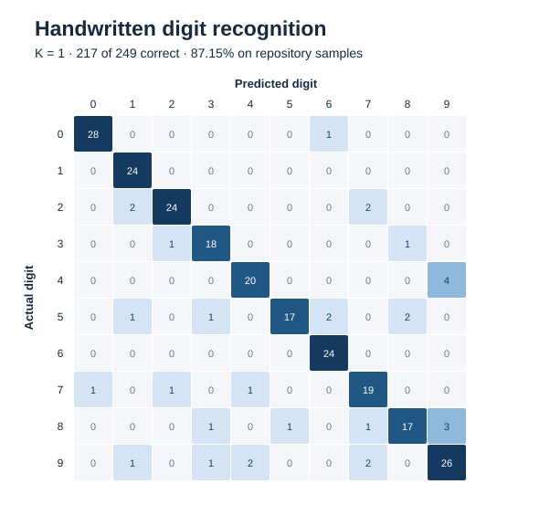

# Java KNN 手写数字识别

本项目实现了基于K最近邻(K-Nearest Neighbors, KNN)算法的手写数字识别系统。通过对MNIST数据集的训练和测试，展示了KNN算法在图像分类任务中的应用。

## 项目概述

KNN算法被用于分类MNIST数据集中的手写数字图像。项目包括数据预处理、模型训练、预测以及性能评估等关键步骤。同时，项目还实现了不同K值下的错误率分析和可视化。

## 单次实验结果

使用仓库自带 CSV 文件，以欧氏距离运行一次 **K = 1**。训练集有 1,199 条记录，测试集有 249 条，其中 **217 条预测正确（87.15%）**。图中的行是真实标签，列是预测标签，每格为样本数。此结果仅适用于仓库内这次课程数据划分。



复现时按下文准备 CSV，并在临时副本中将主程序的 K 循环限制为一次。刚启动的程序会从空混淆矩阵开始计数。

## 目录

- [安装指南](#安装指南)
- [使用方法](#使用方法)
- [文件结构](#文件结构)
- [算法描述](#算法描述)
- [数据集](#数据集)
- [性能评估](#性能评估)
- [可视化](#可视化)
- [贡献](#贡献)
- [许可证](#许可证)

## 安装指南

需要 JDK 和可显示 Swing 图表的桌面环境。将 [JFreeChart 1.0.19](https://repo.maven.apache.org/maven2/org/jfree/jfreechart/1.0.19/jfreechart-1.0.19.jar) 和 [JCommon 1.0.23](https://repo.maven.apache.org/maven2/org/jfree/jcommon/1.0.23/jcommon-1.0.23.jar) 下载到仓库根目录的 `lib/` 中。

## 使用方法

```bash
git clone https://github.com/jackguo2016/java-knn-mnist.git
cd java-knn-mnist
mkdir -p lib src/com/ZiyanGuo build
```

放好两个 JAR 后，从仓库根目录执行以下命令。先把 CSV 复制到代码读取的固定路径。

```bash
cp ML_KNN_digit-recognizer/out/production/ML_KNN_digit-recognizer/com/ZiyanGuo/traincsv.csv src/com/ZiyanGuo/
cp testSet.csv src/com/ZiyanGuo/
javac -encoding UTF-8 -cp "lib/*" -d build Main.java Data.java graph.java
java -cp "build:lib/*" com.ZiyanGuo.Main
```

Windows 的 Java 类路径分隔符为 `;`。糖尿病数据的对应实现见 [`java-knn-diabetes`](https://github.com/jackguo2016/java-knn-diabetes)。

## 文件结构

- `Main.java`: 包含主要逻辑，包括数据加载、KNN实现和结果可视化。
- `Data.java`: 定义了用于存储和管理单个数据点的Data类。
- `graph.java`: 处理错误率可视化的图表创建。
- `testSet.csv`: 用于测试的数据集。
- [`traincsv.csv`](ML_KNN_digit-recognizer/out/production/ML_KNN_digit-recognizer/com/ZiyanGuo/traincsv.csv): 用于训练的 MNIST 数据，保存在原 IntelliJ 编译目录。

## 算法描述

KNN算法步骤：

1. 加载训练数据
2. 对于每个测试样本：
   a. 计算与所有训练样本的距离
   b. 选择K个最近邻
   c. 进行多数投票，确定类别
3. 评估模型性能

本项目使用欧氏距离作为距离度量，并实现了不同K值的性能比较。

## 数据集

项目使用MNIST手写数字数据集：
- `traincsv.csv`: 训练数据，包含手写数字图像的像素值和对应标签。
- `testSet.csv`: 测试数据，用于评估模型性能。

## 性能评估

项目计算并展示：
- K 从 1 到 19 时的错误率和准确率。
- 一张跨多个 K 值累计的混淆矩阵。它不能直接作为某个单独 K 值的结果。

## 可视化

项目包含两种可视化：
1. K值与错误率关系的折线图。
2. 混淆矩阵的热力图表示（在报告中）。

## 贡献

欢迎对项目进行改进和扩展。请随时fork仓库并提交pull请求。

## 许可证

原 README 提及 MIT 许可证，当前仓库未附对应文件。

---

## 原课程报告摘录

当前 Java 实现使用欧氏距离。下方保留原课程报告，其中也记录了糖尿病实验及尝试过的其他距离度量。

本项目旨在通过实现KNN算法来解决手写数字识别问题，展示了机器学习在图像分类任务中的应用。通过调整K值和分析不同距离度量方法，我们可以深入理解KNN算法的工作原理及其在实际问题中的表现。
Programming Task: For each dataset, you must create a K-NN classi_er that uses the training data to build a classi_er, and evaluate and report on the classi_er performance.


There is the changes of error rate under different values of k.

Here the K value is from 1 to 50, and the y-axis represents the error rate on the x-axis.

 
（Now using the Minkowski distance test method）

 
 （The euclidean metric method is now used）


 
（The Manhattan Distance method is now used）

Here is some scatter plots show a big picture of the data:
    

(End of pima-indians-diabetes-database graph)


digit-recognizer dataset:
Here is Error rate of number 8 with different k values:  


I randomly divided the whole database into 20% test set and 80% sample set, The error rate of the learning results at this ratio is much lower than the 50% 50% error rate.


(15 points) Algorithm Description: K-NN is a very clear algorithm, so here describe any data pre-
processing, feature scaling, distance metrics, or otherwise that you did.

data preprocessing:
For the data of these two datasets, I created a unique class in the program called data class. Then put these data into the data class for preprocessing according to the different characteristics of each row of data.

feature scaling:
In the data set about diabetes, there is a feature value of insulin, and his value will vary greatly. So in order to narrow the effect of this value on the overall prediction results, I limited this value to be between zero and 1. In this way, its influence on other eigenvalues can be reduced and the overall accuracy can be improved.

distance metrics:
In k-means or kNN, we often use Euclidean distance to calculate the distance between nearest neighbors, and sometimes Manhattan distance. In the diabetes dataset I used all three distance test methods to better improve the accuracy. Then in the handwritten font recognition dataset, I chose to use the Manhattan distance to calculate the distance based on the accuracy of the diabetes dataset.


Pima Dataset：

This is happen when k = 2 and k = 3.
 
Accuracy is 72% for k = 2.

digit-recognizer dataset:
 
complete confusion matrix:
 
single digit 8 to measure accuracy and number varies as a function of K:  
Accuracy around 80%


For the run-time of your algorithm since the loop in the knn function, So the run-time of it will be O(N).


## Project history

Former repository name: `ML_KNN_digit-recognizer`. This repository preserves the original coursework and its development history.
